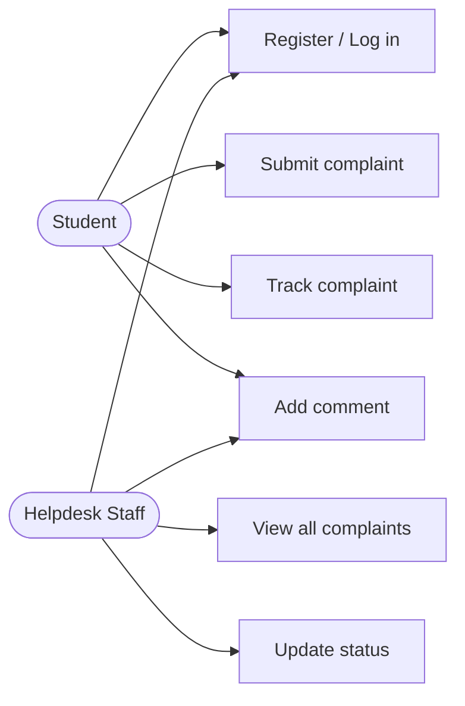
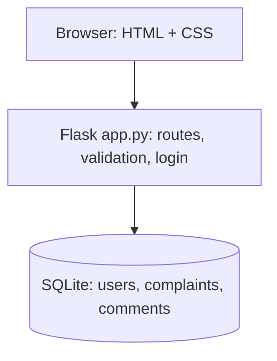
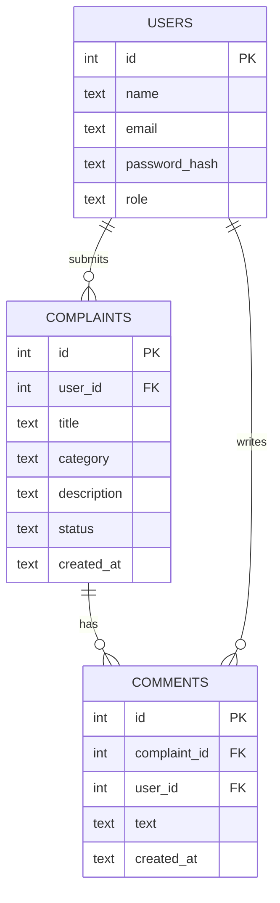
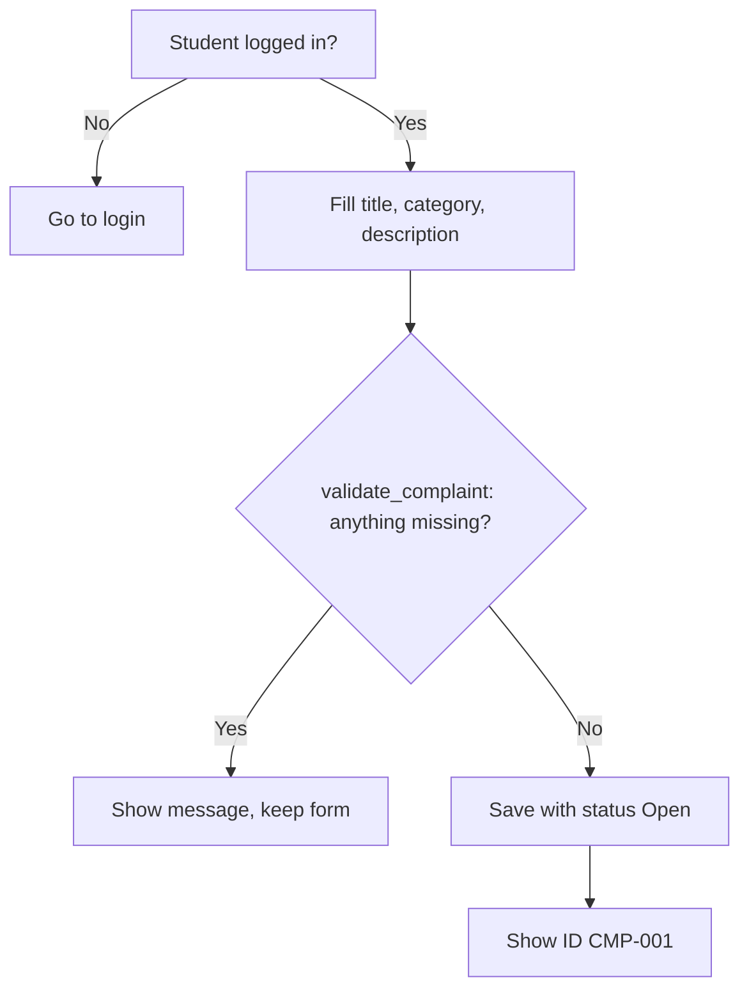

# UHCMS – Design Documents
(Diagrams are Mermaid: they render on GitHub, or paste into https://mermaid.live)

## 1. Requirements (SRS summary)
FR-01 login · FR-02 submit complaint · FR-03 choose category · FR-04 unique ID (CMP-001) · FR-06 staff update status · FR-07 student views status · FR-08 comments.
NFR-02 passwords hashed · NFR-03 usable without training · NFR-05 modern desktop browsers.
User stories: US-01 submit, US-02 track, US-04 staff updates status.

## 2. Use-case diagram

## 3. Architecture (three tier)

## 4. ER diagram

## 5. Flowchart – submit complaint

## 6. Status lifecycle
Open → In Progress → Resolved → Closed (staff only).

## 7. Traceability
| Requirement | Story | Test |
|---|---|---|
| FR-01 | – | TC-02 test_wrong_password |
| FR-02/04 | US-01 | TC-03 test_valid_complaint_gets_id |
| FR-02 | US-01 | TC-04 test_empty_description_rejected |
| FR-06/07 | US-04/02 | TC-05/06 test_staff_updates_status_student_sees_it |
| Security | – | test_student_cannot_change_status |

## 8. Known limitations
No email notifications, file upload, priority or assignment yet (planned for Sprint 2). Change the seeded staff password before any real use.
